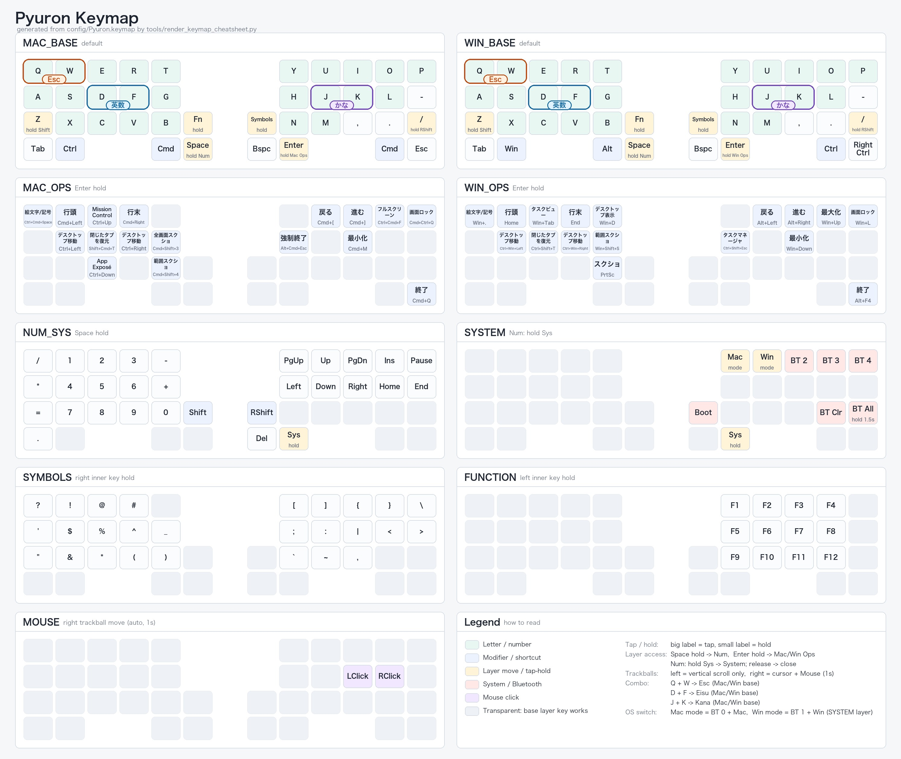

# ファームウェア更新手順とキーマップの編集

## キーマップ早見表

現在生成済みの早見表を以下に表示します。拡大する場合は画像をクリックしてください。

Mac／Windowsとも端末側をUS配列に設定して使う構成です。NUM_SYSは共通で、Windows専用のJIS変換レイヤーはありません。

- Windows OPSの行頭・行末はHome／Endです。文書全体の先頭・末尾へはCtrlを併用します。
- SYSTEMの「BT All」は1.5秒長押しで全Bluetooth接続設定を消去します。短押しでは何も起きません。隣の「BT Clr」は従来どおり単押しです。
- Windows右下は右Ctrl。その左は左Ctrlです。
- 英数はD＋F、かなはJ＋Kのコンボで入力します（両OSのベースのみ、50ms判定）。
- 元かなキーを押している間はFUNCTION、元英数キーを押している間はSYMBOLSを開き、離すと戻ります。専用のかな・英数キーはありません。
- SYMBOLSはNUM_SYSの数字と同じ位置にUS配列のShift記号を配置（8の位置には * を配置）。NUM_SYSの0は左手下段右端です。記号はSYMBOLSにまとめ、数値入力で使う四則演算・＝・小数点はNUM_SYSに配置し、* は数字のShift記号としてSYMBOLSにも配置しています。FUNCTIONは右手側の左4列に、上段F1〜F4・中段F5〜F8・下段F9〜F12を配置しています。
- SYMBOLSにはNUM_SYSの / - + = . を除くUS記号27種類を配置。左端は上から `?`・シングルクォート・ダブルクォートで、`?` は `!` の左隣です。右側は上段から左詰めにし、記号の間の空きをなくしています。OPSの記号は透過に変更しました。NUM_SYSには左上から「/・−」、中段「*・＋」、下段左端「＝」、左下「.」を配置し、5.6などをレイヤーを切り替えず入力できます。ベースの句読点は維持しています。
- 単独のF1〜F12はFUNCTIONだけに配置。OPSのF2・F11、NUM_SYSのF6〜F10は透過に変更しました。Alt＋F4などの固定ショートカットは維持しています。
- EscはQ＋Wのコンボで入力します。Macでは右下のEscも使えます。
- WindowsのH＋J（Win）とO＋P（右Ctrl）のコンボは削除しました。
- Space長押しでNUM_SYS、Enter長押しで各OSのOPSを開きます。
- NUM_SYSでは「かな」の位置が左Shift、「英数」の位置が右Shiftです。左Shiftは矢印での範囲選択、右Shiftは数字との記号入力に使えます。通常レイヤーでは元かなキーがFキーレイヤー、元英数キーが記号レイヤーの保持キーです。
- NUM_SYSのDelete右隣を押している間、SYSTEMを開きます。

[HTML版](docs/keymap-cheatsheet.html) / [テキスト版](docs/keymap-cheatsheet.md)

## ZMK Studioによるキーマップの編集
### 手順1. 有線接続でキーマップを変更する場合は[ZMK Studio](https://zmk.studio/)にアクセス
### 手順2. 中央にある"USB"をクリックしてデバイスを選択することでキーマップの編集が可能になります。
### 手順3. 無線接続でキーマップを変更する場合は[ZMK Studioネイティブアプリ](https://zmk.studio/download)にアクセスしてファイルをダウンロード
### 手順4. インストール後に起動、接続中のデバイスが表示されるのでデバイスを選択するとキーマップの編集が可能になります。

## Keymap-Editorによるキーマップの編集 (Githubアカウントが必要になります)
### 手順1. [Pyuronリポジトリ](https://github.com/MeowCatpawkittie/zmk-config-Pyuron) リポジトリをFork
### 手順2. Actionsタブを選択して"I understand my workflows, go ahead and enable them"をクリック
### 手順3. [Keymap-Editor](https://nickcoutsos.github.io/keymap-editor/)にアクセス
### 手順4. Githubでログインをしたあと"Only select repositories"を選択、"Add Repository"をクリック
### 手順5. 再度"Only select repositories"を選択、"Install"をクリック
### 手順6. キーマップが表示され、編集可能になります。
### 手順7. 編集が完了したら左上の"Save"をクリック、ビルドが完了すると"Latest"からダウンロードできます。
### ダウンロードしたファームウェアは以下の手順で書き込んでください。

## ファームウェアの書き込み

### 手順1. PCと右側ボードを接続します。
### 手順2. 表にあるリセットスイッチ用のボタンを2回素早く押すとブートローダーが起動して"XIAO SENSE"として認識されます。
### 手順3. まずは"XIAO SENSE"ドライブに"settings_reset-seeeduino_xiao_ble-zmk.uf2"を書き込みます。
### 手順4. 次に同じ手順でブートローダーを起動し"Pyuron_R rgbled_adapter-seeeduino_xiao_ble-zmk"を書き込みます。
### 手順5. 右側が終わったら左側も同じように"settings_reset-seeeduino_xiao_ble-zmk.uf2"から"Pyuron_L rgbled_adapter-seeeduino_xiao_ble-zmk"を書き込みます。
### 手順6. 書き込みが完了したら念の為1回リセットボタンを押してください。
### 手順7. 左右どちらも電源をオンにしたあとにBlutoothデバイスの追加から"Pyuron"を選択し、接続ができたらファームウェアの書き込みは完了です。

#### ・ファームウェアの書き込みの際エラーが出ていても実際には正常で書き込めています。手順を進めて問題ありません。
#### ・ファームウェアを更新する際は一度PC側のデバイスから削除して再度ペアリングをしてください。
